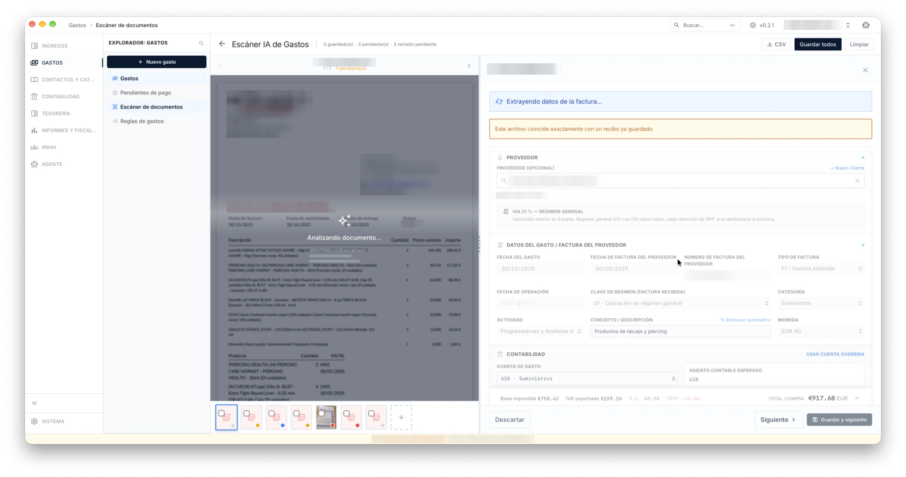

<!-- Logo: reemplazar por la imagen de la web -->
<!--  -->

# Fixco

### Tu facturación, tu contabilidad y tus impuestos, en una app que trabaja por ti.

La aplicación de escritorio para Mac, Windows y Linux, para **autónomos, pymes y gestorías** en España.
Pensada desde el primer día para **VERI\*FACTU**, con un asistente de IA que entiende tu negocio
y que puedes usar desde el móvil.

**[Quiero probarla →](#-prueba-cerrada)**

<!-- Captura principal: reemplazar por la imagen de la web -->
<!--  -->

---

## 💻 Una app de escritorio, no otra web más

Fixco se instala en tu ordenador y **funciona aunque no tengas internet**. Tus facturas, tu contabilidad y tus clientes viven en tu equipo, en una base de datos **cifrada** para cada empresa, no en el servidor de nadie.

- **Rápida**: nada de esperar a que cargue una página. Buscas, abres y editas al instante.
- **Tuya**: los datos no dependen de que un proveedor siga existiendo ni de que pagues una cuota para poder consultarlos.
- **Varias empresas** en la misma app, cada una en su propio archivo. Ideal si llevas varios negocios o si eres gestoría.
- **Se actualiza sola**: cuando hay una versión nueva, te ofrece *Instalar y reiniciar*. Sin volver a descargar nada.

---

## 🤖 Un asistente de IA que hace el trabajo, no sólo lo explica

Pídele lo que necesites en lenguaje natural:

> *"Hazle una factura a Construcciones Pérez por la reforma del baño, 2.400 € más IVA."*
> *"¿Qué clientes me deben dinero desde hace más de 60 días?"*
> *"Registra el cobro de la factura 2026-0142, me han pagado por transferencia."*

El asistente busca, prepara y registra documentos, y te enseña paso a paso lo que va haciendo. **Tú decides cuánta autonomía le das**:

- En **modo guiado**, te pide permiso antes de cada cambio.
- En **modo autónomo**, avanza solo en lo que se puede deshacer, **siempre** se detiene antes de mover dinero y sólo emite facturas definitivas si tú se lo permites expresamente.
- ¿Se ha equivocado? **Deshaz** lo que hizo en un clic.

### Conecta tu propia IA

Usa la que ya tienes, **aunque sea gratuita**. Hoy funciona con:

- **ChatGPT**, también con una cuenta gratuita
- **Google Gemini**, también con una cuenta gratuita
- **Claude**, de Anthropic
- **IA local**, que funciona **en tu propio ordenador**: sin internet y sin que tus datos salgan de tu equipo

Te conectas con tu cuenta en un par de clics, sin configurar nada.

> 💡 **Para empezar no necesitas pagar nada.** Con una cuenta gratuita de ChatGPT o de Google puedes facturar y consultar tu negocio con el asistente en el día a día. Si un día llegas al límite de uso que fija tu proveedor, puedes conectar otra cuenta o pasarte a la IA local, que no tiene límites.

Las cuentas que conectas son **tuyas, no de la empresa**: sus credenciales se guardan cifradas en tu equipo y no viajan con los datos de la empresa, aunque compartas el archivo con tu gestoría.

---

## 📱 Tu negocio, también desde el móvil

Empareja tu móvil con tu ordenador y usa el asistente desde donde estés: pregunta cuánto te deben, prepara una factura o registra un gasto sin tener que sentarte al ordenador (basta con que esté encendido y con Fixco abierto). Tú eliges qué empresas puede abrir el móvil y puedes desemparejarlo cuando quieras.

---

## 📸 Gastos sin teclear, y sin duplicados

Arrastra o fotografía las facturas de tus proveedores, **de una en una o por lotes**, y Fixco las lee por ti: proveedor, fechas, bases, tipos de IVA, retenciones y líneas.

Antes de guardar nada, **comprueba**:

- 🔁 **Si ya la tienes**: el mismo archivo, el mismo número de factura del mismo proveedor, o la misma fecha e importe. También dentro del mismo lote, aunque subas dos veces el mismo PDF.
- 🏷️ **Cómo clasificarla**: te sugiere la cuenta de gasto y te avisa si algo no cuadra.
- 🧾 **Si de verdad es para ti**: te avisa si la factura va dirigida a otra empresa.

  

Y para los cobros: **importa el extracto del banco** y Fixco descarta los movimientos que ya tenías y te propone con qué factura casar cada uno.

---

## ✨ Todo lo que necesitas para llevar tu negocio

### 🧾 Facturación VERI\*FACTU
Facturas con huella encadenada, código QR y envío automático a la AEAT. Rectificativas, anticipos, series, **igualas y facturas recurrentes**, presupuestos que se convierten en factura y **Facturae** para la Administración pública.

### 📒 Contabilidad que se hace sola
**Plan General Contable PYMES completo**, con subcuentas de 8 dígitos. Cada cliente y proveedor tiene su propia cuenta, colgando de la que elijas (400, 410, 430, 440…), y puedes crearla al vuelo desde el buscador de cuentas. Cada factura, gasto y cobro genera su asiento: libro diario, mayor y cuenta de resultados siempre al día.

### 🏛️ Impuestos preparados
Borradores de los modelos **303, 390, 111, 115, 123, 130, 180, 190, 193, 200, 202, 347, 349 y 369**, calculados con tus propios datos. También con criterio de caja (RECC).

### 💶 Tesorería y bancos
Cobros y pagos parciales, conciliación bancaria y remesas SEPA. Facturas en moneda extranjera con su tipo de cambio, y las diferencias de cambio contabilizadas solas.

### 🏢 Y además
Productos y stock, inmovilizado y amortizaciones, informes, personal y nóminas, y envío de facturas y presupuestos por email desde tu propia cuenta.

<!-- Galería: reemplazar por capturas de la web -->
<!--

  
  

  
  

-->

---

## ⬇️ Descargar e instalar

Si ya tienes acceso, descarga la última versión desde **[Releases](https://github.com/Ligrila/Fixco/releases/latest)**:

| Tu Mac | Archivo |
|---|---|
| Chip Apple (M1 o posterior) | `Fixco_x.y.z_aarch64.dmg` |
| Intel | `Fixco_x.y.z_x64.dmg` |

| Otros sistemas | Estado |
|---|---|
| 🪟 Windows | En desarrollo |
| 🐧 Linux | En desarrollo |

¿No sabes cuál tienes? Menú  → *Acerca de este Mac*: si dice "Chip Apple M…", es chip Apple.
En Mac necesitas **macOS 14 (Sonoma) o posterior**. Si usas Windows o Linux, apúntate igualmente a la prueba: te avisaremos en cuanto esté lista.

1. Abre el `.dmg` y arrastra **Fixco** a *Aplicaciones*.
2. La primera vez, macOS puede avisar de que no puede verificar la app. Abre *Ajustes del Sistema → Privacidad y seguridad*, baja hasta el aviso sobre Fixco y pulsa **Abrir igualmente**. Sólo hace falta una vez.

Las notas de cada versión están en [Releases](https://github.com/Ligrila/Fixco/releases).

---

## 🔒 Prueba cerrada

Fixco está en **prueba cerrada**: ya la usan empresas reales y abrimos plazas poco a poco, para acompañar de cerca a cada una.

Si quieres sumarte, escríbenos a **[testers@fixco.es](mailto:testers@fixco.es?subject=Quiero%20probar%20Fixco)** y cuéntanos:

1. **Tu nombre** y el de tu negocio o despacho.
2. **Qué eres**: autónomo, sociedad o gestoría/asesoría (y, si eres gestoría, cuántos clientes llevas más o menos).
3. **Tu actividad**: a qué te dedicas.
4. **Cuántas facturas emites al mes**, aproximadamente.
5. **Qué usas hoy**: otro programa, Excel, tu gestoría…
6. **Tu ordenador**: si es un Mac, si tiene chip Apple (M1 o posterior) o Intel y la versión de macOS; si no, si usas Windows o Linux.

No nos envíes NIF, certificados ni datos de facturas por email: no los necesitamos para darte acceso.

**[Quiero probar Fixco →](mailto:testers@fixco.es?subject=Quiero%20probar%20Fixco)**

